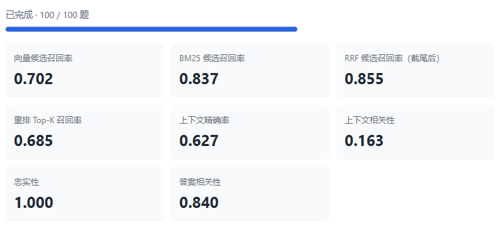
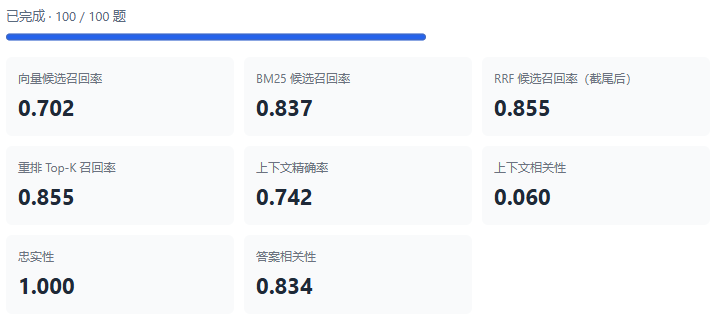
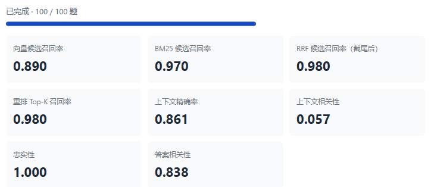
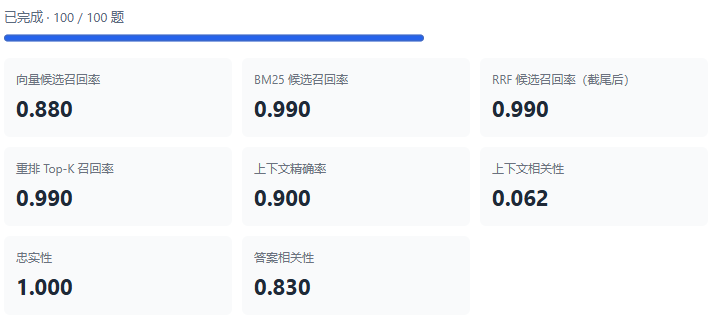

# RAG-study

这是一个用 Python 实现的检索增强生成（RAG）学习项目，使用 FastAPI 提供接口、LangGraph 编排检索流程。系统支持文档上传、解析和切分，通过 Elasticsearch 进行关键词与向量混合检索，经重排后生成带来源引用的答案。内置批量评测功能，可分析检索效果和回答质量。

为了评测 RAG 的效果，我准备了 **6 份不同格式的文件**，包括 Markdown（`.md`）、纯文本（`.txt`）、Word（`.docx`）、PDF（`.pdf`）、Excel（`.xlsx`）和 CSV（`.csv`）。并使用 AI 根据这 6 份文件的内容生成了 **100 条测试用例**。

以下内容主要记录我在调优过程中遇到的问题与解决方案。

### 评测指标

<table id="evaluation-metrics" border="1" cellspacing="0" cellpadding="6">
  <thead>
    <tr>
      <th scope="col">层次</th>
      <th scope="col">指标</th>
      <th scope="col">计算方式</th>
      <th scope="col">核心问题</th>
    </tr>
  </thead>
  <tbody>
    <tr>
      <td rowspan="2">检索层</td>
      <td>Context Recall（向量、BM25、RRF、重排 Top-K 分阶段召回率）</td>
      <td>Ground Truth（GT）对应的 Context 块被阶段检索结果覆盖的比例</td>
      <td>GT 块是在哪一步丢失的？</td>
    </tr>
    <tr>
      <td>Context Precision（上下文精确率）</td>
      <td>在 Top-K 每次命中 GT 分块时，记 <code>累计命中数 ÷ 当前名次</code>，加和后除以 <code>min(K, GT 分块数)</code>。</td>
      <td>找对的分块有没有排在前面？</td>
    </tr>
  </tbody>
  <tbody>
    <tr>
      <td rowspan="3">生成层</td>
      <td>Context Relevancy（上下文相关性）</td>
      <td>用 judge LLM 从上下文中抽取回答该问题所必需的句子或完整表格行，计算它们占全部可计数内容的比例</td>
      <td>检索到的上下文中，有多少内容是真正与问题相关的？</td>
    </tr>
    <tr>
      <td>Faithfulness（忠实度）</td>
      <td>用 judge LLM 把答案拆成原子 claim，逐条判断是否被上下文支持</td>
      <td>生成的答案是否忠实于检索到的上下文？</td>
    </tr>
    <tr>
      <td>Answer Relevancy（答案相关性）</td>
      <td>judge LLM 根据答案反推 3 个问题，取它们与原问题的平均余弦相似度</td>
      <td>回答切题吗？</td>
    </tr>
  </tbody>
</table>

### 基线评测

我针对总计100题的测评集进行了第一次评测，结果如下：

全量召回率从 RRF 截尾后的 **85.5%** 降至 rerank 后的 **68.5%**。这是各阶段中证据损失最大的一步。进入 RRF 候选的标注切片可能在两个环节被淘汰。

1. **排序靠后。** 切片在 rerank 后落在前 5 名之外，被 Top-5 截断。
2. **分数未过线。** 切片的 rerank 分数低于 0.5，即便在原始排序中位于前 5 名，也会被过滤。

逐题核对发现，标注切片进入 RRF 候选共计 105 次，最终保留 84 次。丢失的 **21 次均低于 0.5**，且 **全部在 rerank 排序中已位列前 5**。以评测集中第 8 题为例，标注切片已进入 RRF 候选，但该题最高 rerank 分数仅为 0.49，最终返回的上下文为空。

因此第一步的调优做法是保持双路召回配置，将 BGE sigmoid 阈值降至 0.05，此外增加保护分支，强制取 rerank 重排后的前三条，只有排名第4和第5的块才受阈值过滤。

### 第二轮评测

我用同一份 100 题评测集进行了第二轮评测，结果如下图所示：

降低 rerank 过滤阈值并加入空结果保护分支后，重排 Top-5 召回率从基线的 **68.5%** 提升至 **85.5%**，提高了 **17 个百分点**。

此时的问题主要在于 **26** 次标注切片未进入 RRF 候选，因此尝试将每路的召回数量上调至10（考虑到我们目前上传的文档数并不多）

### 第三轮评测

我用同一份 100 题评测集进行了第三轮评测，结果如下图所示：

提高了召回数量后，无论是向量候选召回率还是BM25候选召回率都有所提高，RRF合并后几乎召回了所有的标注切片。

但在多次重复测评时发现结果并不稳定。例如有一个测试用例提问：哪起事件仍处于复盘中？对应标注切片BM25有时能检索到，有时不能检索到，排查后发现是提问改写后无法稳定保留“复盘中”这个关键词。

因此尝试在问题改写的提示词中加上约束：**请注意，如果有一些关键性的状态描述，请完整保留状态的描述，不能改写后导致状态描述变化**。

### 第四轮评测

问题改写提示词优化后结果如下：

